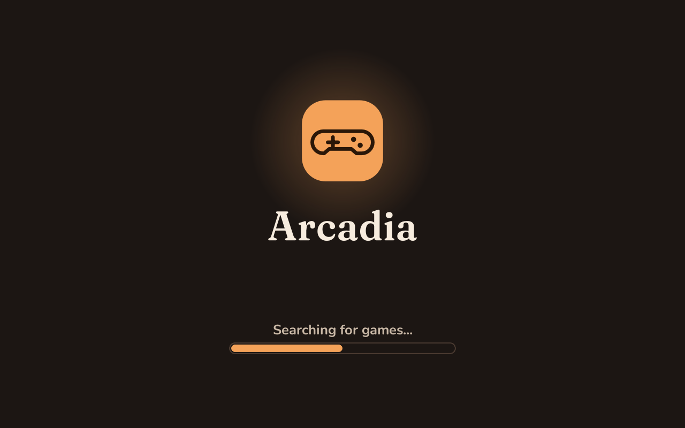
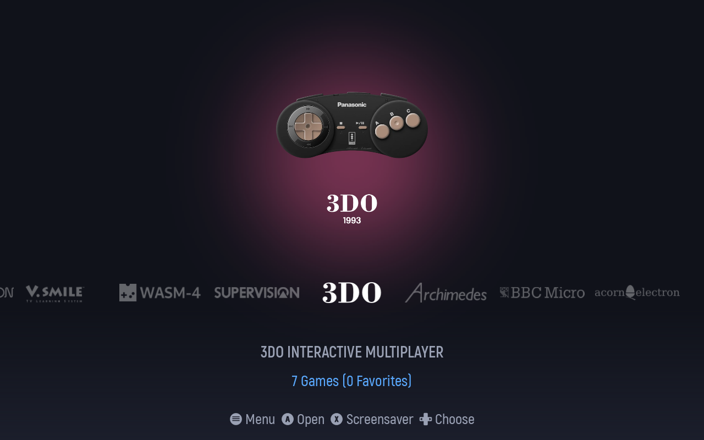
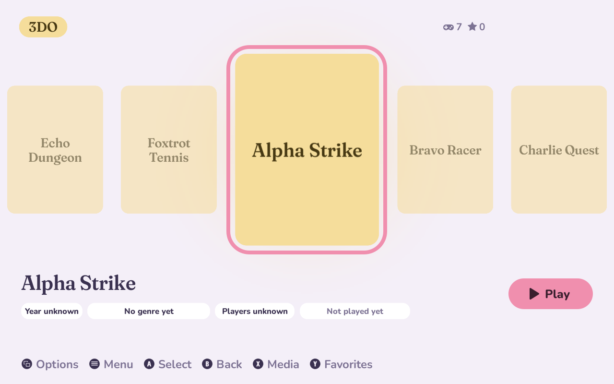
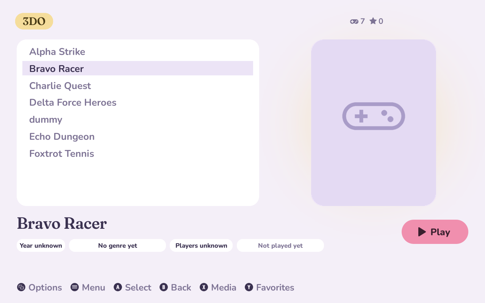
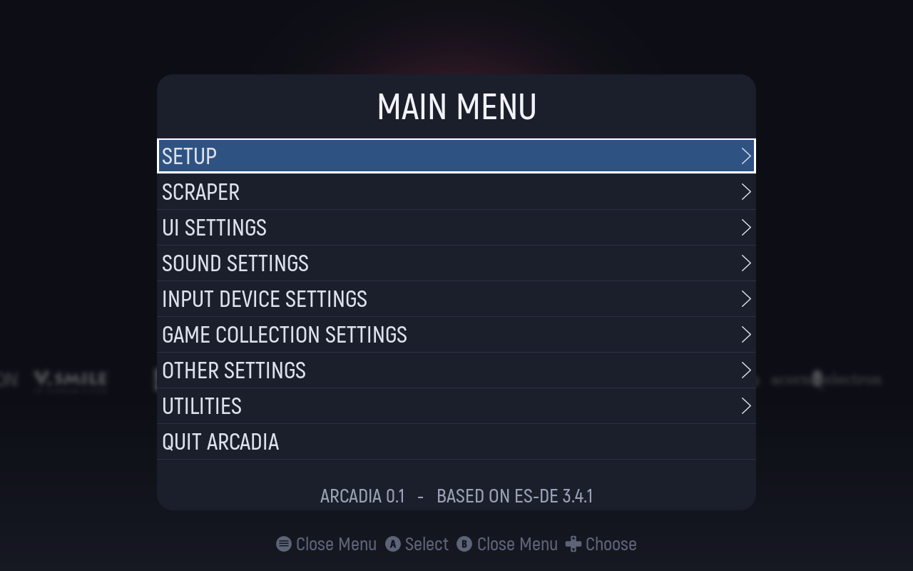
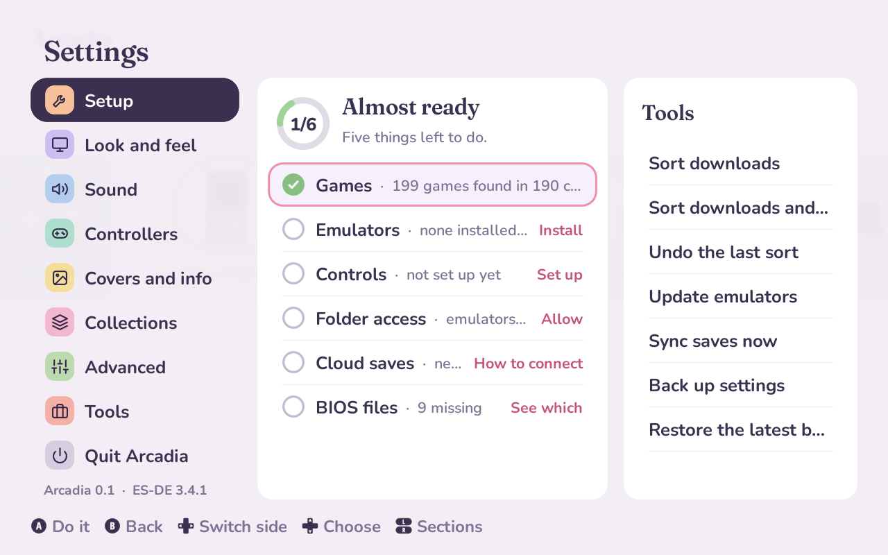
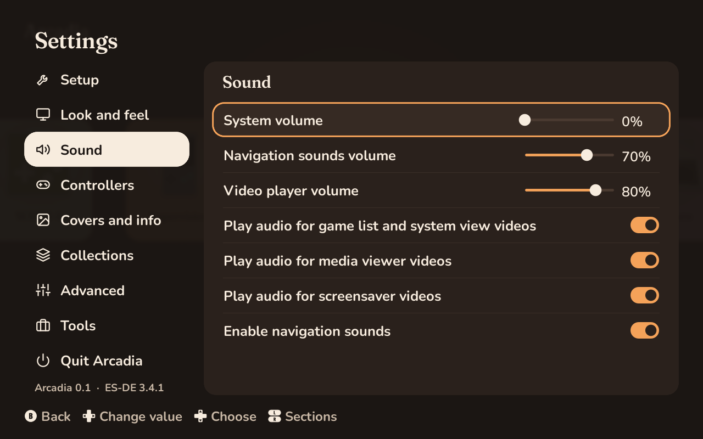
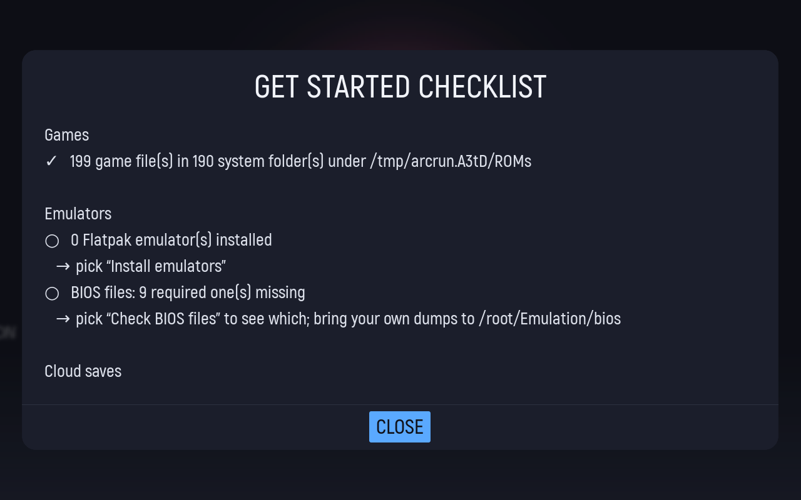
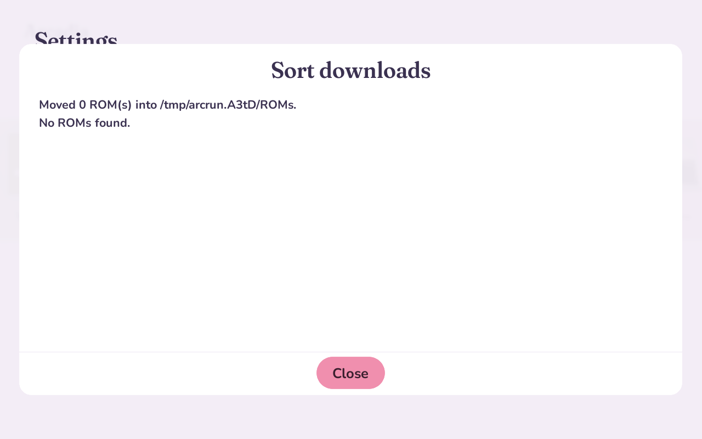
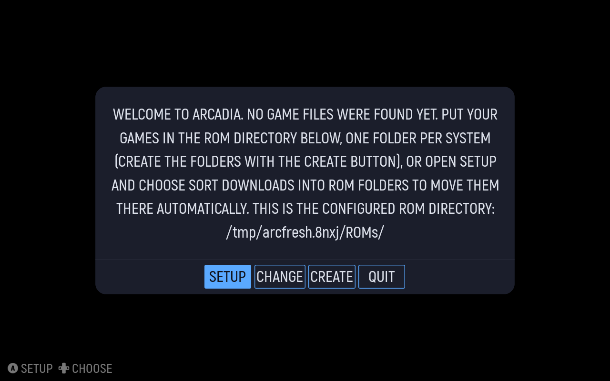

# Arcadia

A game launcher for the Steam Deck (and any Linux PC): browse your consoles and games with a controller, launch them in the
right emulator, keep your saves in the cloud, and set it all up from inside the app.

Arcadia is a full fork of [ES-DE](https://es-de.org) (MIT licence). It keeps ES-DE's engine (scanning, scraping, launching,
themes, controller input) and has its own look (`DESIGN.md`), its own defaults for the Deck, and its own setup tools.

- **A cozy look of its own:** carousels of pastel console cards and game covers, a settings screen with a section rail,
  soft pastels, rounded shapes and plain words. `DESIGN.md`
- **Windowed on the desktop, full screen in Game Mode**, controller works with no Steam layout
- **Setup tools:** sort downloaded ROMs into the right folders (with undo), install and update emulators, check BIOS files,
  starter controller settings, cloud save sync (rclone / Google Drive), backup and restore, self-update. `deck/README.md`
- **A sister app, Deckhand,** for everything that isn't retro: Windows programs and games, game stores, streaming and
  Deck add-ons. See below.
- Linux and Steam Deck only

## Sister app: Deckhand

Arcadia and [Deckhand](https://github.com/PossiblyPengu/deckhand) are a pair for getting started on a Steam Deck. Arcadia
does retro games (ROMs, emulators, BIOS files, emulator saves); Deckhand installs Windows programs and games, game stores
(Epic, GOG, Battle.net…), game streaming and Deck add-ons, and adds them to Steam. Each installs the other:
Arcadia's Setup screen has a "Windows games and stores" step (`deck/tools/get-deckhand.sh`) that runs Deckhand's
checksum-checked installer or opens Deckhand if it's there, and Arcadia is first in Deckhand's Add-ons, which downloads
this repo's AppImage release and adds it to Steam. On a Deck with neither, `curl -fsSL https://raw.githubusercontent.com/PossiblyPengu/deckhand/main/get.sh | bash -s -- --with-arcadia` installs both.
Deckhand follows this file's design language (see its `DESIGN.md`), so the two look like one suite.

## Screenshots

Taken from the program itself at 1280x800 (the Deck's screen), with test games that have no art yet:

| | |
|---|---|
|  |  |
|  |  |
|  |  |
|  |  |
|  |  |

## Build

```bash
sudo apt install build-essential cmake gettext libharfbuzz-dev libicu-dev libsdl2-dev libavcodec-dev libavfilter-dev \
  libavformat-dev libavutil-dev libfreeimage-dev libfreetype6-dev libgit2-dev libcurl4-openssl-dev libpugixml-dev \
  libasound2-dev libbluetooth-dev libgl1-mesa-dev libpoppler-cpp-dev
cmake -G Ninja -DCMAKE_BUILD_TYPE=Release . && ninja
./arcadia
```

The Steam Deck AppImage is built by `.github/workflows/steamdeck-appimage.yml` (or `tools/create_AppImage_SteamDeck.sh`).
After first start, run `./deck/install.sh` to add the setup tools.

## Documents

- `USERGUIDE.md` how to install and use Arcadia
- `DESIGN.md` the design language
- `FORK.md` what differs from ES-DE
- `deck/README.md` the setup tools behind the SETUP menu
- `docs/es-de/` ES-DE's own documents (user guide, install and theme guides, changelog), kept for reference

Arcadia is based on ES-DE by Leon Styhre and contributors; see `CREDITS.md` and `LICENSE`.
